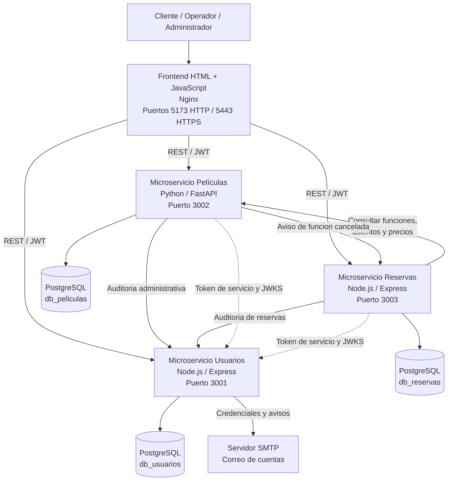
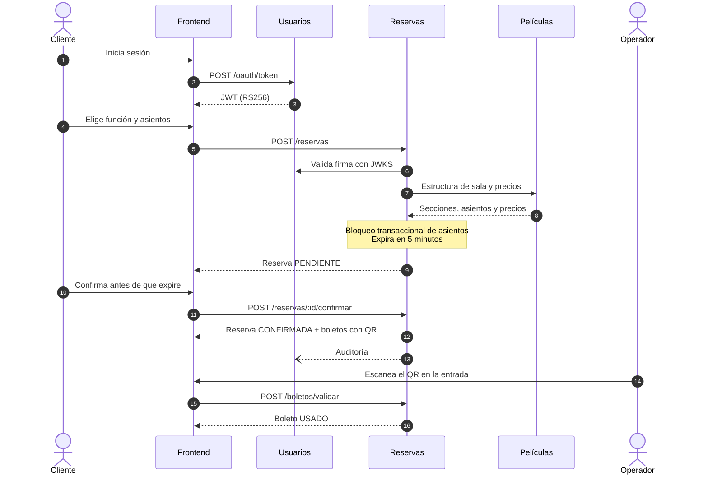
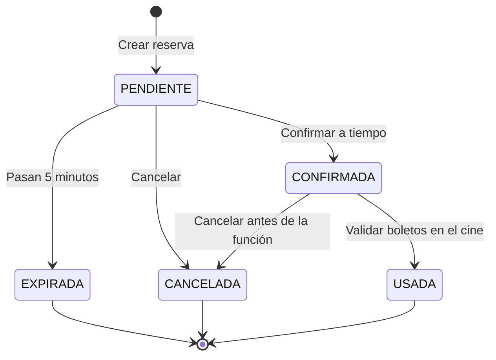
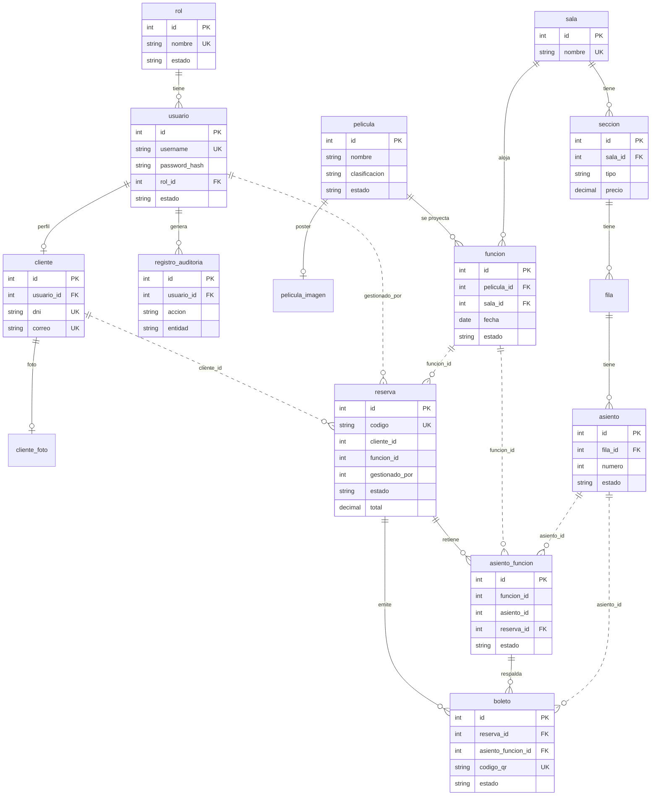

<div align="center">

# 🎬 Cine Andino

### Sistema de reservas de cine con microservicios

Elige tu función, escoge tus asientos en el mapa y recibe tus boletos con código QR.
Todo en una arquitectura distribuida, segura y lista para celular.


[Requisitos](#-requisitos-previos) ·
[Inicio rápido](#-inicio-rápido) ·
[Arquitectura](#-arquitectura) ·
[Flujo de reserva](#-flujo-de-una-reserva) ·
[Modelo de datos](#-modelo-de-datos) ·
[API](#-api-principal) ·
[Celular con HTTPS](#-abrir-desde-el-celular-con-https) ·
[Pruebas](#-pruebas-automáticas)

</div>

---

## ✨ Qué incluye

| | Funcionalidad |
|---|---|
| 🎟️ | **Mapa de asientos** por sección (VIP, DBOX y General) con reserva de hasta 6 boletos por compra |
| ⏱️ | **Cuenta regresiva de 5 minutos** para confirmar; si no, la reserva expira y los asientos se liberan |
| 🔳 | **Boletos con QR** firmado, de un solo uso, validables por código o con la cámara |
| 👥 | **Tres roles**: Administrador, Operador y Cliente, con OAuth 2.0 y JWT firmado con RS256 |
| 📊 | **Reportes** individuales y generales con rango de fechas |
| 🕵️ | **Auditoría** de todas las acciones del personal |
| 🖼️ | **Pósters y fotos de perfil** guardados en PostgreSQL |
| 📱 | **Interfaz responsiva**: tablas que se vuelven tarjetas, mapa de asientos adaptable y menú táctil |
| 🔍 | **Búsquedas sin tildes ni mayúsculas**: «codigo cuantico» encuentra «Código Cuántico» |

---

## 🏗️ Arquitectura

Tres microservicios independientes, **una base PostgreSQL por servicio** y un frontend servido por Nginx. Comparten un contrato común ([`docs/contrato.md`](docs/contrato.md)) y se validan los tokens entre sí sin compartir secretos.



### Dueño único de cada dato

| Microservicio | Puerto | Tecnología | Es dueño de |
|---|:---:|---|---|
| 👤 **Usuarios** | `3001` | Node.js · Express · Sequelize | `rol`, `usuario`, `cliente`, `cliente_foto`, `registro_auditoria` |
| 🎞️ **Películas** | `3002` | Python · FastAPI · SQLAlchemy | `pelicula`, `pelicula_imagen`, `funcion`, `sala`, `seccion`, `fila`, `asiento` |
| 🎫 **Reservas** | `3003` | Node.js · Express · Sequelize | `reserva`, `asiento_funcion`, `boleto` |

> Las referencias entre servicios (`reserva.cliente_id`, `reserva.funcion_id`, `asiento_funcion.asiento_id`, `reserva.gestionado_por`) son **IDs lógicos sin clave foránea física**.

---

## 📋 Requisitos previos

Elige **una** de las dos formas de ejecutar el proyecto:

| | 🐳 Con Docker (recomendado) | 🛠️ Sin Docker |
|---|---|---|
| **Qué instalas** | [Docker Desktop](https://www.docker.com/products/docker-desktop/) (Windows y macOS) o Docker Engine con Compose v2 (Linux) | Node.js 20+, Python 3.11+ y PostgreSQL |
| **Bases de datos** | Se crean solas (PostgreSQL 16 en contenedores) | Las creas tú: 3 bases vacías |
| **HTTPS y cámara en el celular** | ✅ Incluido (Nginx) | ❌ No incluye |
| **Sistema operativo** | Windows, macOS o Linux | Linux, macOS, o Windows con WSL / Git Bash (el script de arranque es bash) |

Comprueba que lo necesario esté instalado:

```bash
# Con Docker
docker --version
docker compose version        # debe funcionar "docker compose" (Compose v2)

# Sin Docker
node --version                # v20 o superior
python --version              # 3.11 o superior (en Linux/macOS: python3 --version)
psql --version
```

> 💡 Con Docker Desktop, ábrelo antes de ejecutar los comandos y espera a que indique que está en ejecución.
> Opcional: **Git** para clonar el repositorio y **Node 18+** para correr las pruebas.

<details>
<summary><b>🔌 Puertos que usa el proyecto</b></summary>

<br>

Deben estar libres en tu equipo antes de arrancar.

| Puerto | Uso |
|:---:|---|
| `5173` | Frontend por HTTP |
| `5443` | Frontend por HTTPS (necesario para la cámara en el celular) |
| `3001` · `3002` · `3003` | Microservicios Usuarios, Películas y Reservas |
| `5433` · `5434` · `5435` | PostgreSQL de Usuarios, Películas y Reservas (solo con Docker) |

</details>

---

## 🚀 Inicio rápido

### Con Docker (recomendado)

```bash
git clone <URL-DE-TU-REPOSITORIO>
cd cine-reservas
cp .env.example .env              # en Windows PowerShell: Copy-Item .env.example .env
docker compose up --build
```

La primera vez tarda varios minutos porque descarga las imágenes y construye los servicios. Cuando termine, comprueba que todo esté arriba:

```bash
docker compose ps                 # los 7 servicios deben aparecer en ejecución
```

| Qué | Dirección |
|---|---|
| 🎬 Aplicación | http://localhost:5173 |
| 🔒 Aplicación por HTTPS | https://localhost:5443 |
| 📘 Swagger Usuarios | http://localhost:3001/docs |
| 📘 Swagger Películas | http://localhost:3002/docs |
| 📘 Swagger Reservas | http://localhost:3003/docs |

Para detener el proyecto:

```bash
docker compose down               # detiene y conserva los datos
docker compose down -v            # detiene y BORRA las bases de datos
```

> 💡 Si algo falla al construir, revisa los registros con `docker compose logs <servicio>` (por ejemplo `usuarios`, `peliculas`, `reservas` o `frontend`). Si dice que un puerto está ocupado, cierra el programa que lo usa o cambia el puerto en `docker-compose.yml`.

<details>
<summary><b>🛠️ Sin Docker</b></summary>

<br>

Necesitas Node 20+, Python 3.11+ y PostgreSQL en marcha. En Windows usa **WSL** o **Git Bash**, porque `start-local.sh` es un script bash.

**1. Crea las tres bases vacías**

```bash
psql -U postgres -c "CREATE DATABASE db_usuarios;"
psql -U postgres -c "CREATE DATABASE db_peliculas;"
psql -U postgres -c "CREATE DATABASE db_reservas;"
```

**2. Instala dependencias y arranca**

```bash
cd backend/usuarios  && npm install && cd ../reservas && npm install && cd ..
cd peliculas && python -m venv .venv && .venv/bin/pip install -r requirements.txt && cd ../..
PG_BASE=usuario:clave@localhost:5432 ./scripts/start-local.sh      # arranca los 3 servicios
cd frontend && python -m http.server 5173                         # sirve el frontend
./scripts/start-local.sh stop                                     # detiene los servicios
```

Cambia `usuario:clave@localhost:5432` por tu usuario y contraseña de PostgreSQL. Los registros quedan en `/tmp/cine-logs`.
Al arrancar por primera vez, cada servicio crea sus tablas y carga su **archivo semilla** (`seed.js` / `seed.py`).
Si la semilla falla, usa los scripts de respaldo de `sql/` (crean y pueblan cada base).

</details>

### 🔑 Usuarios de demostración

La pantalla de ingreso **no muestra** accesos de demostración. Quien conoce el comando secreto lo escribe en el campo **Usuario** y pulsa «Ingresar»: aparecen botones para entrar como administrador, operador o cliente.

| Usuario | Contraseña | Rol |
|---|---|---|
| `admin` | `Admin123*` | 🛡️ Administrador |
| `operador` | `Operador123*` | 🎟️ Operador |
| `cliente1` | `Cliente123*` | 🍿 Cliente |
| `cliente2` | `Cliente123*` | 🍿 Cliente |

<details>
<summary><b>Cómo funciona el acceso de desarrollo</b></summary>

<br>

- El comando se define en el servicio de Usuarios (`DEV_ACCESS_COMMAND`, por defecto `/dev`). **Cámbialo en tu `.env`.**
- Empieza con `/`, así que nunca puede ser un nombre de usuario válido (los usuarios deben empezar con letra o número).
- Con un comando incorrecto la respuesta es idéntica a un login fallido (no revela que la función existe) y se bloquea tras 5 intentos.
- Las cuentas y contraseñas no están en el código del frontend: las entrega el servidor solo si el comando es correcto.
- Con `DEMO_MODE=false` la función se desactiva por completo (úsalo fuera de desarrollo).

</details>

### 🧪 Prueba el flujo completo en 3 minutos

1. Abre http://localhost:5173, elige el día **Mañana** y una función.
2. Ingresa como `cliente1` (escribe el comando de desarrollo en «Usuario» para ver los accesos).
3. Elige hasta 6 asientos en el mapa y pulsa **Reservar**. Tienes 5 minutos para **Confirmar**.
4. Se emiten los boletos con QR. Míralos en **Mis reservas**.
5. Con `operador` valida un boleto (**Panel → Validar boletos**), escribiendo el código o **escaneando el QR con la cámara**. Revisa también Reservas y el Reporte general.
6. Con `admin` gestiona usuarios y revisa la Auditoría. Solo el administrador ve el botón **Llamadas API** (abajo a la derecha) y la pestaña **Conexiones**.

---

## 🔄 Flujo de una reserva



### Estados de una reserva



### Reglas de negocio

| Regla | Dónde se valida |
|---|---|
| Máximo 6 boletos por compra, una sola función por reserva | Reservas (`LIMITE_BOLETOS`) |
| Un asiento no puede reservarse dos veces en la misma función | Reservas: bloqueo transaccional + índice único `(funcion_id, asiento_id)` |
| Total = suma de precios de las secciones | Reservas, con precios obtenidos de Películas |
| Reserva sin confirmar en 5 min → expirada y asientos liberados | Reservas (tarea cada 15 s + verificación al leer) |
| Sin funciones solapadas en una sala (con 15 min de limpieza) | Películas |
| Boleto con QR único y de un solo uso | Reservas (token firmado con HMAC) |
| El operador no gestiona operadores ni administradores | Usuarios |
| Cuentas inactivas no inician sesión | Usuarios |
| Toda acción del personal queda auditada | Usuarios recibe eventos de Películas y Reservas |

---

## 🗄️ Modelo de datos

Las líneas **continuas** son claves foráneas físicas dentro de un servicio. Las **punteadas** son referencias lógicas entre servicios (se validan por API REST).



> El diagrama muestra solo las columnas clave. El detalle completo está en [`docs/Sistema_Reservas_Cine.dbml`](docs/Sistema_Reservas_Cine.dbml) (se puede abrir en [dbdiagram.io](https://dbdiagram.io)).

<details>
<summary><b>📋 Valores permitidos (idénticos en BD, código, Swagger y frontend)</b></summary>

<br>

| Elemento | Valores |
|---|---|
| Rol | `ADMINISTRADOR`, `OPERADOR`, `CLIENTE` (y `SERVICIO` solo en tokens servicio a servicio) |
| Cuenta | `ACTIVO`, `INACTIVO`, `BLOQUEADO` |
| Película | `ACTIVA`, `INACTIVA`, `RETIRADA` · Clasificación: `TP`, `+12`, `+15`, `+18` |
| Función | `ACTIVA`, `CANCELADA`, `FINALIZADA` |
| Sección | `VIP` ($15), `DBOX` ($10), `GENERAL` ($5) |
| Asiento físico | `ACTIVO`, `BLOQUEADO` (mantenimiento) |
| Asiento en una función | `DISPONIBLE`, `RESERVADO`, `OCUPADO` |
| Reserva | `PENDIENTE`, `CONFIRMADA`, `CANCELADA`, `EXPIRADA`, `USADA` |
| Boleto | `ACTIVO`, `USADO`, `ANULADO` |

</details>

<details>
<summary><b>🔧 Decisiones de diseño respecto al ER original</b></summary>

<br>

- Tabla `cliente_foto` (1 a 1 con `cliente`): foto de perfil.
- Tabla `pelicula_imagen` (1 a 1 con `pelicula`): póster. Van aparte para no cargar los bytes al listar.
- `asiento.estado` (`ACTIVO` / `BLOQUEADO`): bloqueo físico por mantenimiento.
- `reserva.gestionado_por`: usuario del personal que creó la reserva a nombre de un cliente.
- `boleto.etiqueta` y `boleto.seccion_tipo`: copia de datos del asiento para mostrar el boleto sin depender de Películas.
- `boleto.asiento_funcion_id`: la unicidad es **parcial** (solo boletos no anulados). Así un asiento cancelado puede volver a venderse y el boleto anulado queda como historial.
- Administrador y operador también tienen registro en `cliente` (datos personales obligatorios para todos los usuarios).
- Estados de asiento por función: `DISPONIBLE`, `RESERVADO`, `OCUPADO`.

</details>

---

## 📡 API principal

Todos los servicios usan el prefijo `/api/v1`, JSON en `snake_case` y exponen `GET /health` y su Swagger en `/docs`.

<details>
<summary><b>👤 Usuarios (3001)</b></summary>

<br>

| Método | Ruta | Descripción |
|:---:|---|---|
| `POST` | `/oauth/token` | Token con `grant_type` = `password`, `refresh_token` o `client_credentials` |
| `POST` | `/auth/register` | Registro de cliente |
| `POST` | `/auth/setup/username` | Elegir nombre de usuario propio (antes del primer ingreso) |
| `PUT` | `/auth/setup/foto` | Subir foto durante la configuración inicial |
| `POST` | `/auth/change-password` | Cambiar la contraseña propia |
| `GET` `PUT` | `/clientes/me` | Ver y editar el perfil propio |
| `GET` `POST` | `/usuarios` | Listar y crear usuarios (personal) |
| `GET` `PUT` | `/usuarios/:id` | Ver y editar a cualquier persona (administrador) |
| `PATCH` | `/usuarios/:id/estado` | Activar, desactivar o bloquear |
| `GET` `PUT` `DELETE` | `/usuarios/:id/foto` | Foto de perfil |
| `GET` | `/roles` | Catálogo de roles |
| `GET` `POST` | `/auditoria` | Consultar (administrador) y registrar eventos |
| `GET` | `/.well-known/jwks.json` | Clave pública para validar los JWT |

</details>

<details>
<summary><b>🎞️ Películas (3002)</b></summary>

<br>

| Método | Ruta | Descripción |
|:---:|---|---|
| `GET` `POST` | `/peliculas` | Cartelera y alta de películas |
| `GET` `PUT` | `/peliculas/{id}` | Detalle y edición |
| `PATCH` | `/peliculas/{id}/estado` | Activar, desactivar o retirar |
| `GET` `PUT` `DELETE` | `/peliculas/{id}/imagen` | Póster |
| `GET` `POST` | `/funciones` | Listar y programar funciones |
| `GET` `PUT` | `/funciones/{id}` | Detalle y reprogramación |
| `GET` | `/funciones/{id}/estructura` | Sala, secciones, filas y asientos con precios |
| `PATCH` | `/funciones/{id}/cancelar` | Cancelar una función (avisa a Reservas) |
| `POST` | `/funciones/generar-demo` | Genera funciones de demostración (administrador) |
| `GET` | `/salas` · `/secciones` · `/filas` · `/asientos` | Estructura física |
| `PATCH` | `/asientos/{id}/estado` | Bloquear o activar un asiento |

</details>

<details>
<summary><b>🎫 Reservas (3003)</b></summary>

<br>

| Método | Ruta | Descripción |
|:---:|---|---|
| `GET` | `/funciones/:id/asientos` | Disponibilidad de asientos de una función |
| `POST` | `/reservas` | Crear reserva (bloquea los asientos) |
| `POST` | `/reservas/:id/confirmar` | Confirmar y emitir boletos con QR |
| `POST` | `/reservas/:id/cancelar` | Cancelar y liberar asientos |
| `GET` | `/reservas` · `/reservas/mis-reservas` · `/reservas/:id` | Consultas |
| `GET` | `/reservas/:id/boletos` | Boletos de una reserva |
| `GET` | `/boletos/:id/qr.png` | Imagen del código QR |
| `POST` | `/boletos/validar` | Validar un boleto (personal) |
| `GET` | `/reportes/cliente/:clienteId` | Reporte individual |
| `GET` | `/reportes/general` | Reporte general por rango de fechas |
| `POST` | `/internal/funciones/:id/cancelada` | Solo servicio a servicio (rol `SERVICIO`) |

</details>

---

## 🔐 Seguridad

- **OAuth 2.0** en Usuarios con los flujos `password`, `refresh_token` y `client_credentials`.
- **JWT firmado con RS256**. Películas y Reservas validan la firma con la clave pública (JWKS), sin compartir secretos.
- Contraseñas con **bcrypt**. Nombres de usuario reservados bloqueados y acceso de desarrollo protegido contra fuerza bruta.
- QR firmado con **HMAC**, de un solo uso.
- Las imágenes se validan por su contenido real, no solo por la extensión.

---

## 📱 Interfaz responsiva

La interfaz se adapta a celular, tablet y escritorio sin librerías externas.

| Pantalla | Qué cambia |
|---|---|
| 📱 **Celular** (hasta 640 px) | Menú desplazable bajo la marca, tablas convertidas en tarjetas, asientos que se ajustan al ancho, ventanas a pantalla casi completa |
| 📲 **Tablet** (hasta 860 px) | Resumen de compra fijo en la parte inferior mientras eliges asientos |
| 🖥️ **Escritorio** | Contenido centrado de hasta 1240 px en pantallas grandes |
| 👆 **Táctil** | Botones y campos de al menos 44 px, sin zoom automático en iOS |

El archivo `frontend/responsive.js` etiqueta las celdas de las tablas para que, en el celular, cada valor aparezca junto al nombre de su columna.

---

## 📲 Abrir desde el celular con HTTPS

Para **leer los QR con la cámara del celular** hay que abrir la aplicación por **HTTPS**: los navegadores bloquean la cámara en páginas `http://`. El proyecto ya incluye un Nginx que sirve HTTPS con un certificado autofirmado, así que solo hay que prepararlo una vez.

### ✅ Antes de empezar

- El PC y el celular están en la **misma red Wi-Fi**.
- Ejecutas el proyecto **con Docker** (sin Docker no hay HTTPS).
- En Windows, tu red Wi-Fi está marcada como **Privada**.

### Paso 1. Levanta el proyecto

```bash
docker compose up --build
```

### Paso 2. Averigua la IP de tu PC y guárdala en `.env`

El certificado HTTPS tiene que incluir la IP de tu PC. Elige tu sistema:

<details open>
<summary><b>🪟 Windows (automático con el script)</b></summary>

<br>

1. Abre la carpeta `scripts/`.
2. Clic derecho en `abrir-red-local.ps1` → **Ejecutar con PowerShell** (pide permisos de administrador).
3. El script hace tres cosas por ti:
   - abre los puertos `5173`, `5443`, `3001`, `3002` y `3003` en el Firewall para redes privadas,
   - detecta la IP del PC y la guarda en `.env` como `EXTRA_IPS`,
   - te ofrece reiniciar los contenedores (responde **S**) y muestra las direcciones para el celular.

Si el script avisa que tu red es **Pública**, cámbiala a Privada con el comando que te muestra, por ejemplo:

```powershell
Set-NetConnectionProfile -Name "NombreDeTuWiFi" -NetworkCategory Private
```

</details>

<details>
<summary><b>🐧 Linux / 🍎 macOS (manual)</b></summary>

<br>

1. Averigua la IP de tu PC:

   ```bash
   ip a                         # Linux: busca algo como 192.168.1.15
   ipconfig getifaddr en0       # macOS (Wi-Fi)
   ```

2. Escríbela en `.env`. Si tienes varias, sepáralas con coma:

   ```env
   EXTRA_IPS=192.168.1.15
   ```

3. Abre los puertos si tienes firewall (en macOS acepta el aviso cuando aparezca):

   ```bash
   sudo ufw allow 5173,5443,3001,3002,3003/tcp     # Ubuntu / Debian con ufw
   ```

4. Aplica el cambio para que se regenere el certificado:

   ```bash
   docker compose up -d --build
   ```

</details>

<details>
<summary><b>🪟 Windows (manual, sin el script)</b></summary>

<br>

1. Averigua tu IPv4 con `ipconfig` (la del adaptador Wi-Fi, algo como `192.168.1.15`).
2. Escríbela en `.env`: `EXTRA_IPS=192.168.1.15`
3. Abre los puertos desde un PowerShell **como administrador**:

   ```powershell
   New-NetFirewallRule -DisplayName "Cine Andino (red local)" -Direction Inbound -Protocol TCP -LocalPort 5173,5443,3001,3002,3003 -Action Allow -Profile Private,Domain
   ```

4. Reinicia: `docker compose up -d --build`

</details>

### Paso 3. Abre la aplicación en el celular

En el navegador del celular escribe, cambiando por tu IP:

```
https://192.168.1.15:5443
```

La primera vez aparece una **advertencia del certificado**. Es lo esperado: el certificado lo genera el propio proyecto y no lo firma una entidad pública. Acéptala:

| Dispositivo | Qué tocar |
|---|---|
| 🤖 **Android (Chrome)** | *Avanzado* → *Continuar a 192.168.x.x (no seguro)* |
| 🍎 **iPhone (Safari)** | *Mostrar detalles* → *visitar este sitio web* → *Visitar sitio web* |

### Paso 4. Prueba la cámara

1. Ingresa como `operador` (usa el acceso de desarrollo descrito arriba).
2. Ve a **Panel → Validar boletos** y elige **Escanear con cámara**.
3. Cuando el navegador pida permiso, toca **Permitir** y apunta al QR de un boleto.

> 📸 Para tener un QR que escanear, genera antes una reserva confirmada con `cliente1` y muéstrala en otra pantalla.

### Direcciones según cómo lo abras

| URL | Cámara para leer QR | Puertos que deben estar abiertos |
|---|:---:|---|
| `https://IP-DEL-PC:5443` | ✅ Sí | Solo `5443` (Nginx reenvía las APIs en el mismo origen) |
| `http://IP-DEL-PC:5173` | ❌ No | `5173` y `3001`-`3003` |
| `http://localhost:5173` | ✅ Sí (en el propio PC) | No aplica |

### 🩺 Si algo no funciona

| Problema | Qué hacer |
|---|---|
| El celular no carga la página | Verifica que ambos estén en la misma Wi-Fi, que la red sea **Privada** en Windows, que el firewall tenga los puertos abiertos y que no uses VPN. Algunos routers tienen «aislamiento de clientes» o «red de invitados» que impide que el celular vea al PC. |
| Abre, pero el navegador dice «nombre no coincidente» | La IP del PC cambió. Ejecuta de nuevo el script o actualiza `EXTRA_IPS` en `.env` y corre `docker compose up -d`. El certificado se regenera solo. |
| El botón de cámara no funciona | Estás entrando por `http://`. Usa `https://IP:5443` y acepta el permiso de cámara. Si lo negaste antes, actívalo en los permisos del sitio del navegador. |
| Carga la página, pero no inicia sesión ni muestra películas | Si entras por `http://IP:5173`, el celular llama directo a los puertos `3001`-`3003`: ábrelos en el firewall. Por `https://IP:5443` basta el `5443`. |
| `docker compose` dice que un puerto está ocupado | Cierra el programa que lo usa o cambia el puerto en `docker-compose.yml`. |

<details>
<summary><b>⚙️ Cómo funciona por dentro</b></summary>

<br>

- El servicio `frontend` es un Nginx con HTTPS. Genera un certificado autofirmado la primera vez (se guarda en el volumen `nginx_certs` y se regenera solo si cambia `EXTRA_IPS`). Es válido por 825 días e incluye `localhost`, `127.0.0.1` y las IP de `EXTRA_IPS`.
- Por HTTPS, Nginx reenvía las APIs en el mismo origen (`/api/usuarios`, `/api/peliculas`, `/api/reservas`), por lo que no hay CORS ni contenido mixto. `frontend/config.js` lo detecta solo: por HTTPS usa `/api/...` y por HTTP usa los puertos 3001-3003 directos.
- **Sin Docker** (`scripts/start-local.sh`) no hay Nginx ni HTTPS. Los servicios escuchan en toda la red, pero para el frontend debes usar un servidor estático por HTTP, por ejemplo `python3 -m http.server 5173 --bind 0.0.0.0 --directory frontend`, y no tendrás cámara en el celular.
- Es para **demostración en red local**. Fuera de ella usa un certificado real (por ejemplo, con un dominio y Let's Encrypt), `CORS_ALLOW_LAN=false` y `DEMO_MODE=false`.

</details>

---

## 🧩 Más funciones

<details>
<summary><b>👤 Cuentas, perfil y foto</b></summary>

<br>

- **Registro:** el sistema crea la cuenta con un usuario único asignado y envía las credenciales al correo. Justo después se ofrece **elegir un nombre de usuario propio** (4 a 30 caracteres; no se aceptan nombres reservados ni ocupados). Si el cliente cancela, conserva el asignado. Solo se puede elegir antes del primer ingreso y durante 15 minutos (token de configuración de un solo propósito). Al elegir otro se envía un aviso al correo.
- **Foto de perfil (opcional):** se puede subir al registrarse y luego editarla. Si no hay foto, la barra muestra las iniciales (Bryan Aguirre → **BA**). La imagen se reduce en el navegador (256×256) y se guarda en PostgreSQL.
- **Barra superior:** solo el nombre de usuario y un cuadro con la foto o las iniciales. Al hacer clic se abre un menú con el rol, **Editar perfil** y **Cerrar sesión**.
- **Editar perfil (cada usuario, solo el suyo):** nombre, segundo nombre, apellido, nacionalidad, teléfono, dirección, correo y foto. El **DNI está bloqueado**. «Cambiar contraseña» pide la actual, la nueva y su confirmación.
- **Editar a cualquier persona (solo administrador):** Panel → Usuarios → **Editar**. Puede cambiar datos, DNI, foto, **rol** y fijar una **contraseña nueva sin pedir la anterior**. No puede cambiar su propio rol. El operador no puede editar a nadie.

</details>

<details>
<summary><b>🖼️ Pósters de películas</b></summary>

<br>

Los pósters se guardan en **PostgreSQL** (columna binaria en `pelicula_imagen`, separada de `pelicula` para que la cartelera no cargue los bytes). No hace falta otra base de datos: para un cine con decenas de películas es lo más simple, entra en los respaldos y es transaccional. Si algún día hubiera miles de imágenes, la alternativa es un almacenamiento de objetos (S3, MinIO) dejando solo la URL en la base.

- Son **opcionales** al crear una película y se pueden agregar, cambiar o quitar después.
- El administrador y el operador pueden **editar título, descripción, género, duración, clasificación y póster** (Panel → Películas y funciones → Editar).
- Editar una película **no toca** funciones, reservas, asientos ni boletos: las funciones conservan su horario, las reservas siguen confirmadas y los boletos siguen siendo válidos.
- Formatos: JPG, PNG o WEBP, hasta 2 MB (fotos de perfil: 1 MB).

</details>

<details>
<summary><b>📷 Validar boletos con la cámara</b></summary>

<br>

En **Panel → Validar boletos** hay dos modos: **Ingresar código** y **Escanear con cámara**. Al leer un QR se valida de inmediato y se muestra el resultado.

- La cámara solo funciona en `localhost` o con `https` (regla de los navegadores).
- Chrome y Edge en Android o macOS usan el lector nativo; el resto (Firefox, Safari, Chrome en Windows o Linux) usa la librería **jsQR**, incluida en `frontend/vendor/` (Apache-2.0), así que **no necesita internet**.
- La cámara se apaga al cambiar de pantalla o al detener el escaneo.

</details>

<details>
<summary><b>🔍 Búsquedas sin tildes</b></summary>

<br>

Todas las búsquedas ignoran tildes y mayúsculas. Aplica a la cartelera (nombre y género), a la búsqueda `q` de usuarios y a los buscadores de las tablas del panel (usuarios, reservas, películas y auditoría).

</details>

---

## 🧪 Pruebas automáticas

```bash
RESERVA_TTL_SECONDS=20 ./scripts/start-local.sh   # TTL corto para probar la expiración
node scripts/smoke.mjs                            # 130 comprobaciones de punta a punta (Node 18+)
```

Prueba de interfaz (navegador simulado; recorre cliente, operador y administrador; 86 comprobaciones):

```bash
cd scripts && npm install && node ui-test.mjs
```

La prueba de humo cubre: login y roles, reglas de negocio (máx. 6, asiento duplicado, concurrencia de dos clientes por el mismo asiento), confirmación, QR firmado y de un solo uso, expiración, cancelación, reportes (con cruce de cifras) y las integraciones entre servicios (JWKS, auditoría, cancelación de función).

---

## 📌 Estado del proyecto

| Requisito | Estado |
|---|:---:|
| Microservicios Usuarios, Películas y Reservas con REST y Swagger | ✅ |
| Auth OAuth 2.0 + JWT RS256 + roles (Administrador, Operador, Cliente) | ✅ |
| Registro con usuario y contraseña generados y envío por correo (requiere SMTP; sin SMTP se simula y, en modo demo, se muestra en pantalla) | ✅ |
| Mapa de asientos, reserva (máx. 6), expiración a 5 min, boleto con QR por asiento | ✅ |
| Validación de boletos por código o con la cámara; búsquedas sin tildes | ✅ |
| Reporte individual y reporte general con rango de fechas | ✅ |
| Auditoría de acciones del personal | ✅ |
| Semillas por servicio y scripts SQL de respaldo | ✅ |
| Acceso desde el celular por HTTPS (Nginx con certificado autofirmado) | ✅ |
| Interfaz responsiva para celular y navegador | ✅ |
| Diagrama de arquitectura y modelo ER actualizados | ✅ |
| Frontend en React | ⏳ El actual es HTML + JS sin compilación; consume los mismos contratos |
| DevSecOps (GitHub Actions: lint y auditoría de dependencias) | ⏳ |
| Pruebas unitarias por servicio | ⏳ Hay pruebas de integración |
| Recuperación de contraseña por correo, paginación | ⏳ |

---

## ⚠️ Limitaciones conocidas

- Las contraseñas se guardan con **bcrypt** (hash). El enunciado menciona AES256 como ejemplo: confirma con el docente cuál exige.
- El cambio de correo del perfil no se verifica con un enlace de confirmación.
- Al desactivar una cuenta, Usuarios la bloquea de inmediato; Películas y Reservas la reconocen hasta que expire el token (1 h).
- Las funciones de la semilla se generan para 4 días desde el primer arranque. Para crear más: `POST /api/v1/funciones/generar-demo` (administrador) en el Swagger de Películas.
- Los valores por defecto (`estado`, fechas de creación) los pone el código de cada servicio, no la base: si insertas filas a mano en SQL, indica esas columnas.
- Es para **demostración en red local**. Fuera de ella pon `CORS_ALLOW_LAN=false` y `DEMO_MODE=false`, cambia `QR_SECRET` y los `*_CLIENT_SECRET` del `.env` y usa un certificado real (por ejemplo, con un dominio y Let's Encrypt).

---

## 📁 Estructura

```
cine-reservas/
├── backend/
│   ├── usuarios/      Node: model/entities, routes, security (JWKS), seed
│   ├── peliculas/     Python: model/entities, routes, security, seed
│   └── reservas/      Node: model/entities, servicio.js (reglas), reportes.js, seed
├── frontend/          index.html, app.js, styles.css, responsive.js, config.js, vendor/ (jsQR)
├── nginx/             Proxy HTTPS y certificado autofirmado
├── sql/               Respaldo: crea y puebla cada base (generados desde las semillas)
├── scripts/           start-local.sh, abrir-red-local.ps1, smoke.mjs, ui-test.mjs
├── docs/              contrato.md, Sistema_Reservas_Cine.dbml, arquitectura.mmd
├── docker-compose.yml
└── .env.example
```

---

<div align="center">

Hecho con 🍿 · Cine Andino

</div>
